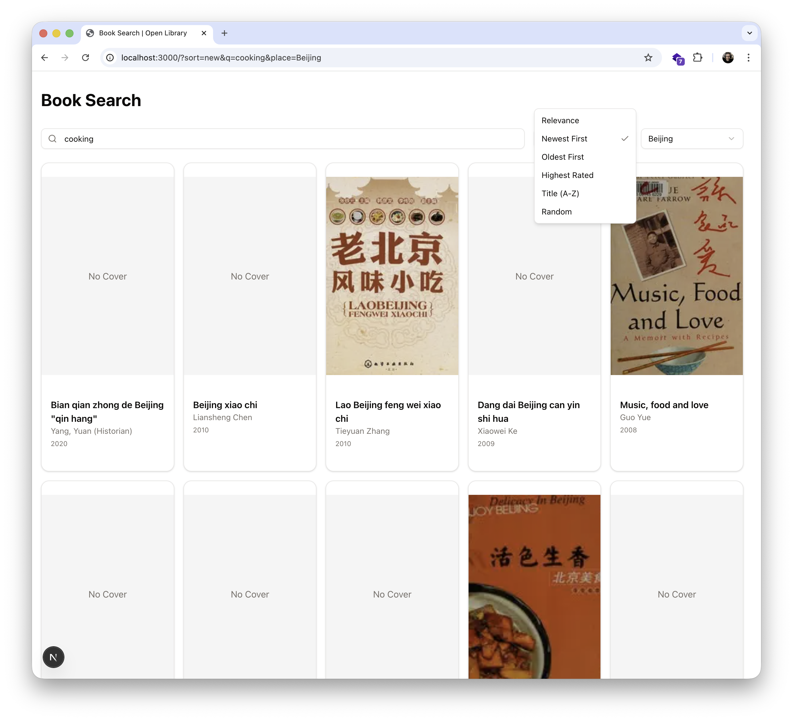
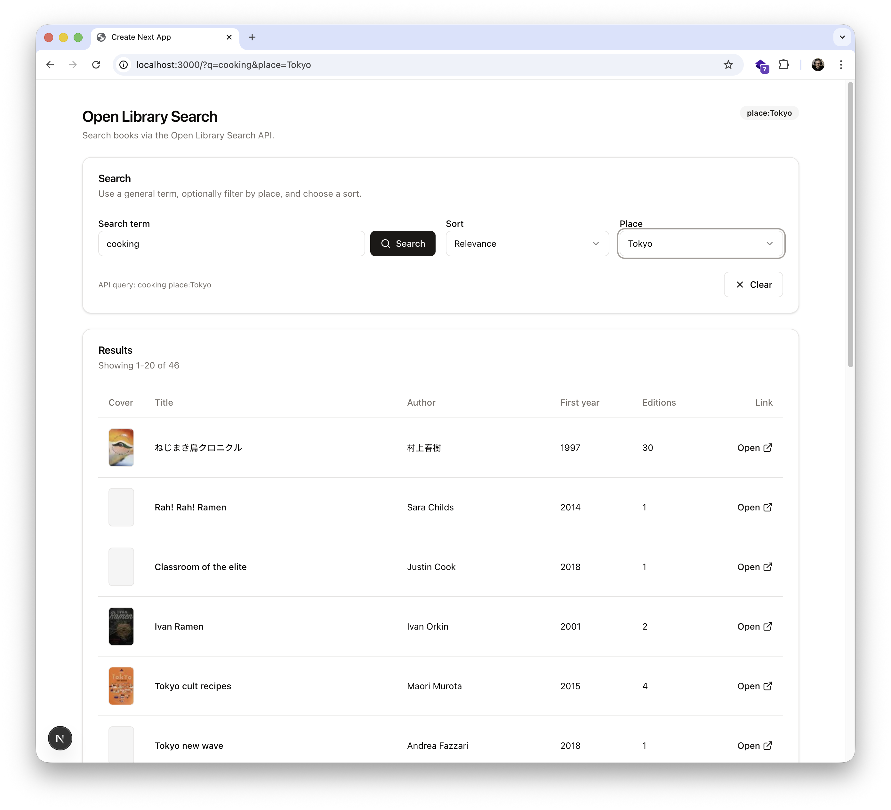
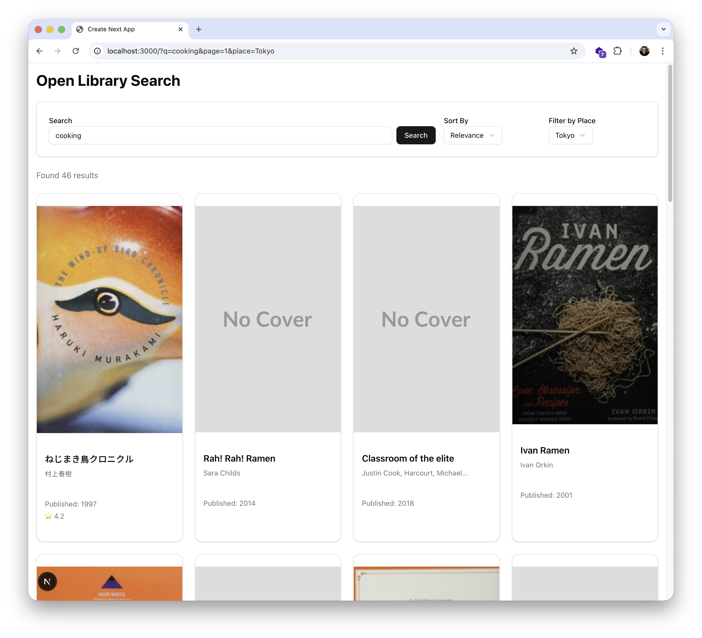

# 01-open-library results

## Claude Code

* Model: opusplan (claude-sonnet-4-5-20250929)
* Duration: ~15 minutes
* Issues:
  * Missed adding the Open Library image domain to Next allowed hosts.
  * Some Select components had an invalid default value and crashed on load. After fixing this, there was initially no way to change back to the default after selecting a different option.
* Other notes:
  * Interesting that it chose to pull in nuqs for query string management.
  * I like Claude Code’s plan mode, in particular the multiple-choice questions it often does before starting.

## Codex

* Model: gpt-5.2 medium
* Duration: ~15 minutes
* Issues:
  * Like Claude Code, some Select components had an invalid default value and crashed on load.
* Other notes:
  * Initially didn’t include images in display rows.

## Gemini CLI

* Model: "Pro" (gemini-3-pro-preview, gemini-2.5-pro fallback)
* Duration: ~5 minutes
* Issues:
  * Place searches initially added ugly text to the query box instead of just updating the select.
  * The place search select didn’t pull the value from the query string on reload.
* Other notes:
  * This was by far the fastest test, around 3x faster than Claude or Codex!
