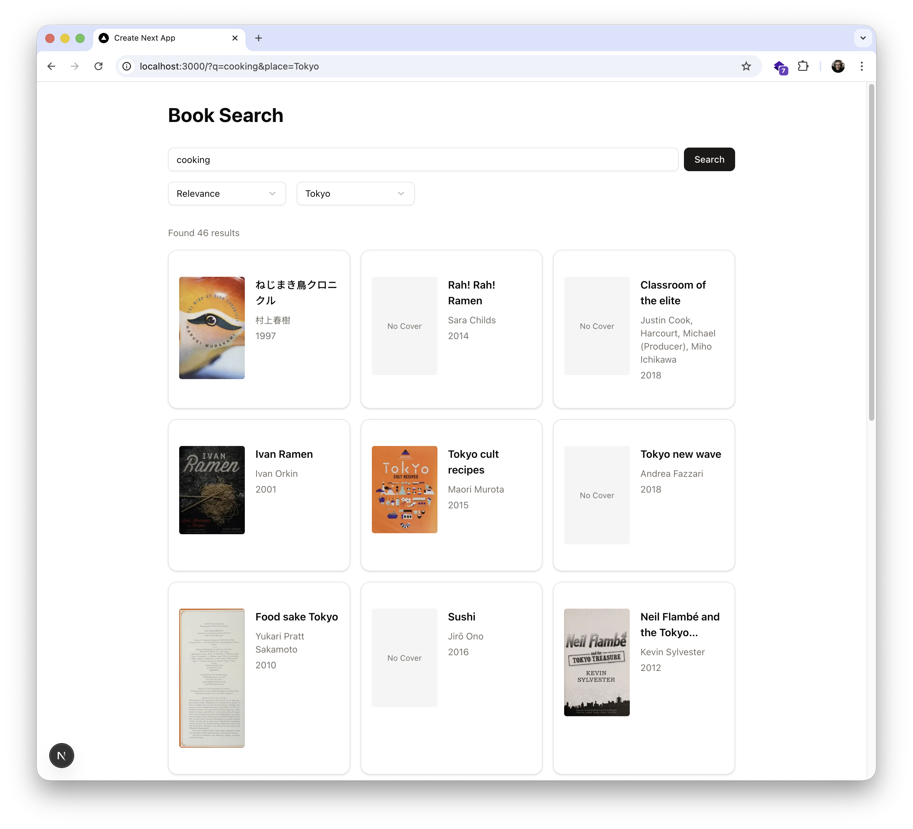
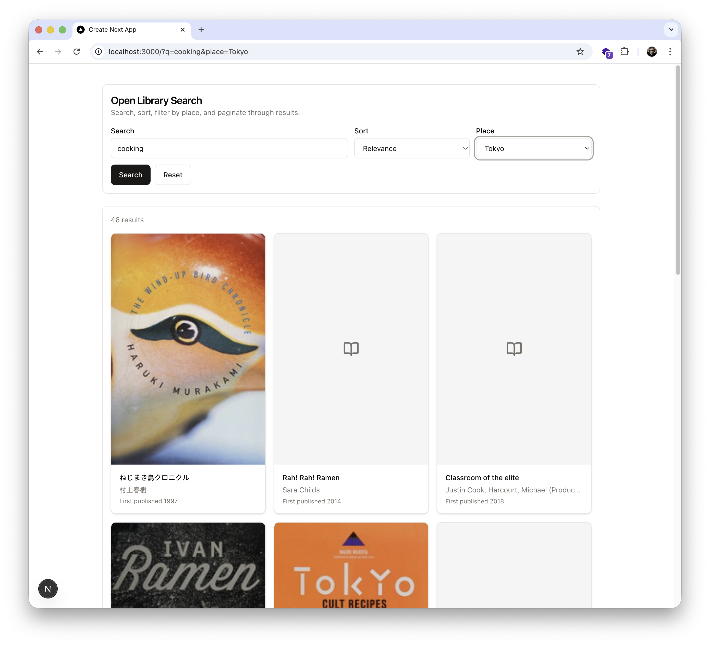
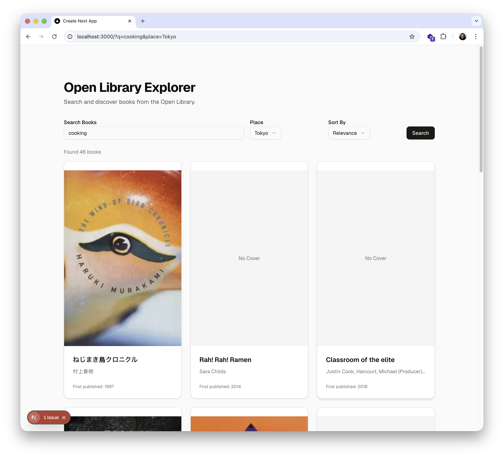
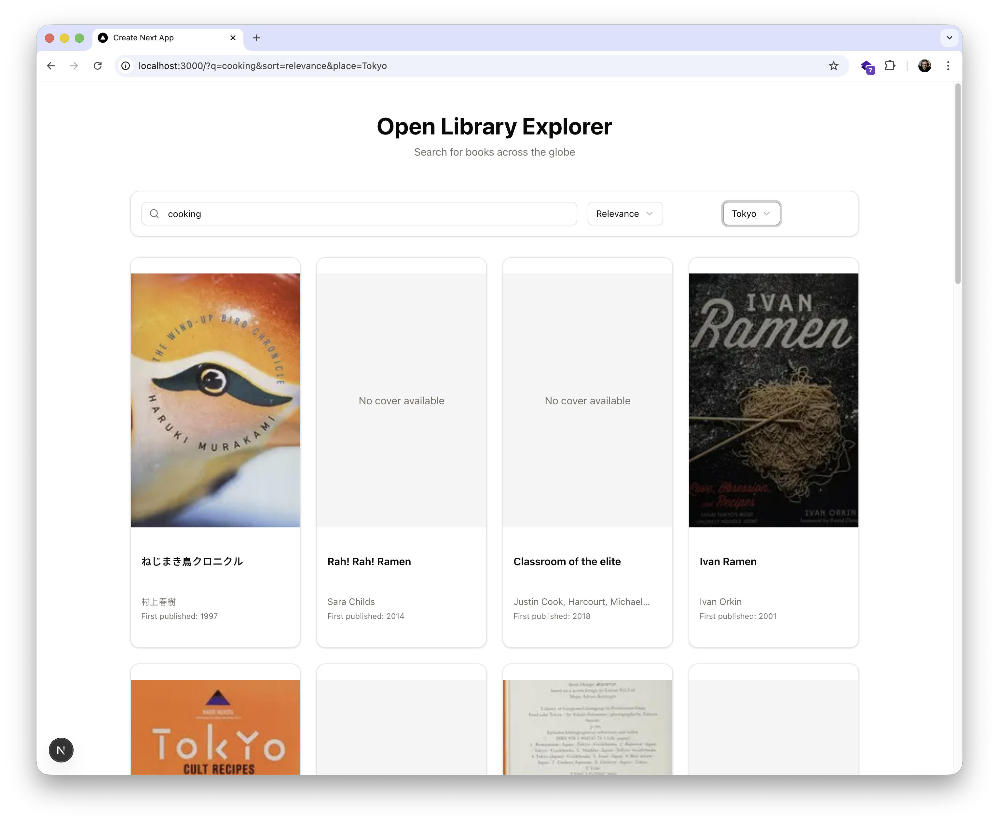

## Claude Code

* Model: opusplan (claude-sonnet-4-5-20250929)
* Duration: ~16 minutes (4, 8, 4)
* Issues:
  * Claude deviated from the prompt in how API instantiation was handled, but I like how plan mode asked me first! I could have easily directed it otherwise at that point, without having to wait for the model to finish its work so I could see what it did.
  * Missed Next.js image host config again.
* Other notes:
  * Claude decided to set up query string persistence as part of step 2. This was also confirmed as part of the plan mode.

## Codex

* Model: gpt-5.2 medium
* Duration: ~26 minutes (5, 11, 10)
* Issues:
  * “0 results · Failed to execute 'fetch' on 'Window': Illegal invocation”
  * “Reset” button actually sets search query to illegal value “the”
  * All results say "Untitled" and "Unknown author", and don’t display the publishing year
* Other notes:
  * The model seemed to have trouble “wrapping up” tasks 2 and 3. Even though they looked mostly done to me, it kept spinning for several minutes without changing much or any code. I’ve seen this behavior fairly often with Codex.

## Gemini CLI (Gemini 3 Pro)

* Model: “Gemini 3” (gemini-3-pro, gemini-3-flash fallback)
* Duration: ~8 minutes (2, 3, 3)
* Issues:
  * I didn’t provide any feedback to the model, each task was a one shot.
* Other notes:
  * Gemini 3 Flash was released earlier today, so Google’s model offerings have been updated. “Pro” (gemini-3-pro-preview, gemini-2.5-pro fallback) used in test 1 is no longer available

## Gemini CLI (Gemini 3 Flash)

* Model: gemini-3-flash-preview
* Duration: ~5 minutes (1, 2, 2)
* Issues:
  * I didn’t provide any feedback to the model, each task was a one shot.
* Other notes:
  * The model chose a floating search bar, which I thought was a nice touch.
